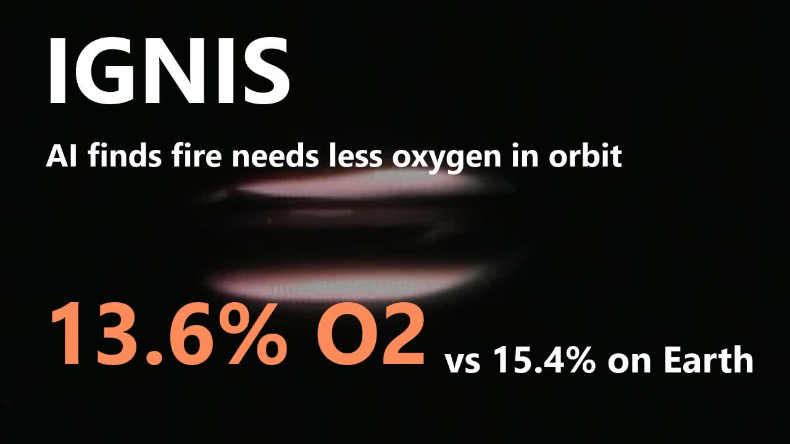
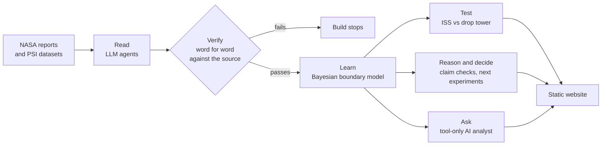

# IGNIS

**An AI that learns where flames stop burning in orbit, from NASA's microgravity combustion data.**

NASA Space Apps Challenge 2026 · *Flame in Freefall: SI-Powered Fire Safety Insights from Microgravity Combustion Data*

**[Live site](https://ignis-ai.study)** · **[Demo video (27 s)](https://youtu.be/V2qWEVosrpI)** · **[Code](https://github.com/TRXAlpha/ignis)**

[](https://youtu.be/V2qWEVosrpI)

## The finding

| | |
|---|---|
| **13.6 % O2** | Lowest oxygen level where acrylic plastic (PMMA) kept burning in orbit (90 % band 13.4 to 13.9 %) |
| **15.4 % O2** | The limit measured in normal gravity, which Earth screening relies on |
| **24 flames** | Burned in microgravity below that Earth limit |
| **3 of 4** | Silicone samples that burned on Earth but went out in orbit (Saffire-II) |
| **158 observations** | From 13 NASA documents and datasets, each traced to its page, figure point or table cell |

An Earth test is not always on the safe side, and not always on the unsafe side either. Each material has to be checked.

## What IGNIS does, in simple words

**The question.** Will a material keep burning in a spacecraft? That depends on how much oxygen is in the air and how
fast the air moves past the flame.

**Why that is hard.** On Earth, hot air rises and feeds a fire with fresh oxygen. In space nothing rises, so a flame only
gets oxygen from fans and air vents. A gentle breeze can keep a flame alive at an oxygen level where it would go out on
Earth. Too much breeze blows it out. No breeze at all starves it.

**The problem today.** Materials for spacecraft are still tested on Earth. An Earth test can say "safe" for a material
that would actually keep burning in orbit.

**What IGNIS does.** It works like a careful research assistant:

1. **AI agents read the data.** They go through NASA's reports and raw tables about real fire experiments on the
   International Space Station and in a drop tower, and pull out every result.
2. **It double-checks everything.** Each number is matched against the exact page it came from. A number that is not
   on the page stops the build.
3. **Machine learning finds the limit.** It learns the line between "keeps burning" and "goes out", and says how sure it is.
4. **It looks at the flight photos itself.** Computer vision tracks the flame in NASA's pictures to measure how fast it spread.
5. **It thinks critically.** It tests the reports' own claims, compares with the Earth rule, and suggests the most useful
   next experiments.
6. **You can ask it questions.** An AI analyst answers only from IGNIS's data. An answer with a number that is not in
   the data is blocked.
7. **It admits what it does not know.** For Moon and Mars air, where nobody has flown fire tests yet, it says
   "not enough data" instead of guessing.

## How it works



| Stage | Technique | Code |
|---|---|---|
| **Read** | LLM agents extract per-test outcomes from report text and digitize published figures | `ingest/`, `registry/` |
| **Verify** | Every extracted value is checked word for word against the hash-pinned source page | `ingest/curated/__init__.py`, `ignis_contract/` |
| **Learn** | Physics-shaped Bayesian model of the burn / extinction boundary, with uncertainty | `model/boundary.py` |
| **Test** | Leave-one-campaign-out validation (ISS vs drop tower) against the normal-gravity rule | `model/export.py` |
| **See** | Computer vision: flame-front tracking in NASA flight stills | `model/video_spread.py` |
| **Reason** | Automated checks of published claims against the data and against each other | `model/contradictions.py` |
| **Decide** | Bayesian active learning picks the next experiments by expected information gain | `model/export.py` |
| **Ask** | Local LLM analyst (Ollama) that answers through tool calls only, with a number guard | `analyst/` |

**Validation result.** Trained on the ISS data and tested on the drop tower, the boundary error is 2.0 % against 2.7 % for
the normal-gravity rule. Trained on the drop tower and tested on the ISS, it is 4.3 % against 6.2 %.

## Run it

Needs Python 3.11 or newer. The flight-imagery step also needs `ffmpeg`.

```bash
python -m venv .venv
.venv/Scripts/python -m pip install -e ".[dev]"                    # Linux/macOS: .venv/bin/python
.venv/Scripts/python -m pytest -q                                  # first-run check (147 tests)
.venv/Scripts/python -m ingest.fetch_sources                       # download NASA PDFs and tables, sha256-checked
.venv/Scripts/python -m ingest.build_bundle                        # data/bundle.json, every value verified
.venv/Scripts/python -m model.video_spread                         # optional: re-measure spread rate (needs ffmpeg)
.venv/Scripts/python -m model.export                               # fit the model, write web/public/data/*.json
.venv/Scripts/python -m http.server 8000 --directory web/public    # open http://localhost:8000
```

Tests that need the NASA files are skipped until `fetch_sources` has run, so run `pytest` again after it.

**Ask the analyst** (needs a local [Ollama](https://ollama.com) model with tool calling; default `gemmaclaude:latest`,
set `IGNIS_LLM_MODEL` for another):

```bash
.venv/Scripts/python -m analyst "What is the minimum O2 for PMMA to burn in microgravity?"
.venv/Scripts/python -m analyst --tool habitats                    # no LLM, raw tool output
```

## Repository layout

| Folder | What is in it |
|---|---|
| `ingest/` | NASA download clients (NTRS, PSI), verbatim-checked transcriptions, plot digitization |
| `registry/` | Sources with hashes, campaigns, materials, habitat atmospheres, per-test outcomes |
| `digitized/`, `data/figures/` | Figure specs, digitized points and the hash-pinned figure renders |
| `contract/`, `ignis_contract/` | Data contract (JSON Schema), unit normalizer and validator |
| `model/` | Boundary model, validation, experiment recommender, habitat risk, claim checks, flight imagery |
| `analyst/` | Tool-calling LLM analyst and its number guard |
| `web/` | Static site (vanilla JS + Plotly), reads `web/public/data/*.json` |
| `tests/` | 147 tests; model tests use synthetic data with a known answer |
| `docs/` | [Demo script](docs/DEMO_SCRIPT.md), [deliverables](docs/DELIVERABLES.md), [open issues](docs/FIX_LIST.md) |

## Data sources

All NASA, all public. Full list with hashes in [`registry/sources.json`](registry/sources.json).

- **BASS-II Summary Report**, NASA/TM-20210011385 ([NTRS](https://ntrs.nasa.gov/citations/20210011385)): the flammability boundary figure, test notes and claims
- **PSI datasets** (CC0): [PSI-25](https://psi.nasa.gov/physci/repo/data/investigations/PSI-25) BASS-II,
  [PSI-26](https://psi.nasa.gov/physci/repo/data/investigations/PSI-26) BASS,
  [PSI-98](https://psi.nasa.gov/physci/repo/data/investigations/PSI-98) /
  [99](https://psi.nasa.gov/physci/repo/data/investigations/PSI-99) /
  [100](https://psi.nasa.gov/physci/repo/data/investigations/PSI-100) Saffire I to III
- **Supporting NTRS reports**: Saffire IV and V results, Zero Gravity Research Facility documents, ISS microgravity
  environment, exploration atmosphere and ISS oxygen management reports
- **NSSDCA Planetary Fact Sheet**: Moon and Mars gravity

## Honest limits

- **Scope.** Thin solid fuels only (mainly PMMA): flame state and spread against oxygen and flow. Droplets, gas jets and
  smoke are in the data contract but not ingested.
- **Machine-read figure.** The 71 boundary points were read off BASS-II Figure 6.10 by marker detection. At least 2 X
  markers hidden behind other markers could not be recovered and are left out, not guessed.
- **Flight-imagery scale.** The spread-rate re-measurement assumes the flame width equals the 2 cm sample. That length
  scale is the main uncertainty, so a "tension" with the report means "scale unresolved".
- **The analyst's guard checks values, not meaning.** It blocks a number that appears in no tool result. It cannot tell
  whether a supported number is used correctly, so recorded answers on the site also carry a human review note.
- **Habitats.** The model only knows microgravity at cabin pressure. Lower pressure or partial gravity returns
  "insufficient data".
- **Gravity** is a campaign nominal (ISS, drop tower), not measured per test. The Saffire g-level is not published on NTRS.

## Use of SI (AI) tools

Disclosed per the Space Apps rules:

- **Code:** written with AI coding assistants, reviewed and tested by the team.
- **Data extraction:** LLM agents read NASA report text and classified per-test outcomes. Every extracted value is
  verified word for word against its source page before use, and each observation records the model that extracted it
  (`bundle.json` → `extraction.model`).
- **Analyst:** a local open-weight model (Ollama) answers questions through tool calls only.
- **Text and design:** README, site copy, demo script and site styling were drafted with AI help and edited by the team.
- **Not SI-generated:** the flight images and video stills are real NASA PSI data (CC0); the demo video footage and
  voice are the team's own. No NASA logos or branding are used.

## Reference

<details>
<summary><strong>Feature status against the original spec</strong></summary>

| Component | Status |
|---|---|
| Ingestion: NTRS | Done: `ingest.ntrs` search/fetch, `ingest.fetch_sources` (sha256-checked), verbatim-checked table transcription |
| Ingestion: plot digitization | Done: `ingest.autodigitize` (ticks + markers -> WPD 4 project + overlay), human WPD path also supported |
| Ingestion: PSI | Done: `ingest.psi` pulls the public CC0 experimental tables (PSI-25, 26, 98, 99, 100) with DOIs and sha256; 66 BASS-II per-test outcomes joined from the report's test notes, every quote verified; Saffire-II 1g rows |
| Ingestion: FLARE | Not ingested (JAXA project, no public table found) |
| Contradiction detector | Done: `model/contradictions.py`, shown as "Consistency Checks" on the site |
| Physics-informed surrogate | Done: `model/boundary.py`. Multi-fidelity was cut; platforms are tested against each other instead |
| Validation | Done: leave-one-campaign-out ISS vs drop tower, plus 5-fold cross-validation, against the 1g rule |
| Experiment recommender | Done: BALD information gain inside the sourced BASS-II facility envelope |
| Habitat risk | Done: ISS cabin, exploration 8.2 psia / 34 % O2, lunar and Mars landers, all sourced |
| LLM analyst | Done as a local CLI. The site shows recorded runs (no server, no keys) |
| Flight-imagery re-measurement (beta) | B1 2.71 ± 0.10 mm/s, B3 4.23 ± 0.31 mm/s against the report's "about 2.2 mm/s" |
| Frontend | Done: https://ignis-ai.study |

</details>

<details>
<summary><strong>Digitizing a plot</strong></summary>

**Automatic (used for BASS-II Fig 6.10):** `python -m ingest.autodigitize bass2_fig6_10` finds the labelled axis ticks
and the markers by colour and shape, then writes a WebPlotDigitizer 4 project (`digitized/<name>.wpd.json`) and an
overlay PNG for review.

**By hand (WebPlotDigitizer 4)**, to correct points or for figures the detector cannot handle:

1. Open https://apps.automeris.io/wpd4/ and load the pinned render, for example `data/figures/bass2_fig6_10.png`
   (made by `python -m ingest.figures render <source_id> <pdf_page> --name <name> --clip x0,y0,x1,y1`).
2. Choose 2D (X-Y) plot. Calibrate X1, X2 on the x-axis and Y1, Y2 on the y-axis at labelled ticks; tick "log scale"
   if the axis is log. Leave "assume axes are perfectly aligned" unticked. For a split axis (Saffire V Fig 10),
   add one axes per side, named as in the spec (`concurrent`, `opposed`).
3. One dataset per legend entry, named exactly as the series keys in `digitized/<name>.spec.json`.
   Click marker centres. Series marked `skip` in the spec can be left out.
4. File > Save Project > save as `digitized/<name>.tar` (keeps the image, so the hash is checked).
5. `python -m ingest.build_bundle` converts and validates. It fails on: wrong image, values that do not match
   WPD's own calibration, unmapped datasets, caption not on the cited page. Tilted calibration (> 3 px)
   flags the points and keeps them out of the model.

</details>

<details>
<summary><strong>Data contract v1.0.0</strong></summary>

| File | What |
|---|---|
| `contract/ignis.schema.json` | JSON Schema 2020-12. Top level = `Bundle`. Also `Prediction`, `Recommendation`, `ValidationFold`, `ConstraintSet`, `HabitatPreset`. |
| `contract/quantities.json` | Canonical SI unit plus hard and plausible range for every numeric field. |
| `contract/examples/bundle.synthetic.json` | Valid example. **Synthetic, not NASA data**; fails `--production`. |
| `ignis_contract/` | Normalizer (`make_quantity`), validator (`check_bundle`), CSV export (`flatten_bundle`). |

**Pipeline:** ingestion writes `data/bundle.json` → the validator checks it in production mode → `model.export` reads
the accepted observations and writes model, validation, recommendation and habitat JSON → the site reads those files.

**Rules the validator enforces:**

- One `Observation` = one outcome, one condition set, one locator (page / figure + point / table + row / dataset path).
- Every number keeps `value` + `unit` as written plus `si_value`; the validator recomputes SI with pint and rejects
  mismatches, including free-form extras such as stretch rate.
- `basis` is `reported` | `reported_elsewhere` | `campaign_nominal` | `derived`. Anything other than `reported` needs
  a `basis_ref`. There is no "assumed".
- Absent = not reported. Only `gravity` is required. A field is never filled with a guess.
- `plot_digitized` rows carry axis calibration, pixel and image hash. `table` needs a row, `text` needs a verbatim quote.
- Confidence below 0.7 or any blocking flag cannot be `accepted`. Outside the plausible range must be flagged.
  Physically impossible is an error.
- IDs are `sha256(locator, quantity, material)`, so re-extraction updates instead of duplicating.
- `test:` / `synthetic_test` sources fail `--production`.
- `Prediction.status = insufficient_data` means `mean_si` must be null. The site shows the empty state, never a number.

**Changing the contract:** additive optional fields are a minor bump (1.1.0). Renames, removals or new required fields
are a major bump. Bump `SchemaVersion` and `SCHEMA_VERSION` together.

</details>
